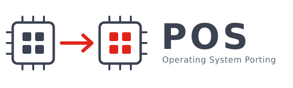

<p align="center">
  
</p>

# POS — Operating System Porting

This is the working tree of the **POS** course (*Portage de systèmes
d'exploitation*) at the [REDS Institute](http://reds.heig-vd.ch/en/rad), HEIG-VD.

Porting an operating system means moving the same code base onto a different
machine — a different CPU, a different memory map, different devices — and making
it come up again. That is what the labs do, with two operating systems and two
kinds of target, all from a single tree and a single build system.

## Targets

| Platform | What it is | How you run it |
|---|---|---|
| `virt32` | QEMU `virt` machine, ARM 32-bit (Cortex-A15) | Emulated — the platform the first labs use |
| `virt64` | QEMU `virt` machine, ARM 64-bit (Cortex-A72) | Emulated |
| `rpi4` | Raspberry Pi 4 + Sense HAT, 32-bit | Real hardware, booted from an SD card |
| `rpi4_64` | Raspberry Pi 4 + Sense HAT, 64-bit | Real hardware, booted from an SD card |

The same tree builds **Linux** (kernel, buildroot root filesystem, user-space
applications and out-of-tree modules) and **SO3**, the compact teaching operating
system developed at REDS. Both go through the same build system, the same
deployment path and the same launcher.

## Quick start

You need Linux and Docker — no cross compiler, no host packages: the build
container carries all of it.

```bash
git clone git@reds-gitlab.einet.ch:reds-bachelor/pos_sol.git
cd pos_sol
. ./env.sh                        # from the ROOT of the tree, once per terminal

dbuild.sh --build                 # build the build container (once, a few minutes)
dbuild.sh build.sh bsp-linux      # compile everything
dbuild.sh deploy.sh bsp-linux     # assemble the boot image + root filesystem
dbuild.sh st.sh                   # boot it under QEMU     (Ctrl-A x to leave)
```

The target is selected by `IB_PLATFORM` in `build/conf/local.conf`. Start with
`virt32`.

`dbuild.sh` with no argument drops you into an interactive shell inside the
container, with the environment already loaded — which is how most people work:
edit outside, build and run inside.

```bash
$ dbuild.sh
[pos-build] ~/pos/pos_sol $ build.sh linux          # just the kernel
[pos-build] ~/pos/pos_sol $ deploy.sh bsp-linux
[pos-build] ~/pos/pos_sol $ st.sh -d                # ... with the graphical screen
[pos-build] ~/pos/pos_sol $ st.sh -g                # ... with the Sense HAT emulator
```

The first build is long — it compiles a cross toolchain, a root filesystem and
the emulator from source. Everything after that is incremental.

## What is in the tree

```
env.sh                  source this first
build/                  the build system: layers (meta-*), conf/local.conf, bitbake
scripts/                build.sh, deploy.sh, st.sh, dbuild.sh, …
docker/build-env/       the build container (Dockerfile, packages.txt, entrypoint)
linux/                  Linux kernel, root filesystem (buildroot), user space
so3/                    the SO3 operating system
u-boot/  qemu/          fetched components, attached here on first build
filesystem/             bootable output: sdcard.img.<platform>, <platform>.itb
sense-hat/              host-side Sense HAT emulator and its bridge
labo/                   the lab handouts
doc/                    the documentation of this tree (see below)
```

`build/` is tracked in git — it holds the layers, never delete it. Only
`build/tmp/` is generated output.

## Documentation

The documentation of **this tree** — build system, container, running,
troubleshooting — lives in [`doc/`](doc/) and is built with Sphinx:

```bash
dbuild.sh make -C doc html        # then open doc/build/html/index.html
```

It deliberately says nothing about **SO3's internals** (architecture, kernel,
system calls, user space, the AVZ hypervisor, capsules). All of that is
maintained upstream, and is far more complete than a copy here would be:

👉 https://smartobjectoriented.github.io/so3

## Credits

POS builds on the **SO3** operating system and the **Infrabase** build system,
both developed at the REDS Institute of HEIG-VD. Our thanks to
[HEIG-VD](https://www.heig-vd.ch) and to everyone — teachers, assistants and
students — whose code, reports and questions keep this material honest.

## License

Released under the [GNU General Public License v2](LICENSE).
