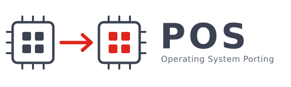

.. POS documentation master file.

.. toctree::
   :maxdepth: 2
   :numbered:
   :hidden:
   :caption: Working with the tree

   getting_started
   container
   build_system
   worktrees
   running
   troubleshooting
   vExpress_register_description
   vExt_json_api

.. toctree::
   :maxdepth: 1
   :hidden:
   :caption: Laboratoires

   labs

===========================================
Welcome to POS — Operating System Porting
===========================================

This is the working documentation of the **POS** course
(*Portage de systèmes d'exploitation*) at the `REDS Institute
<http://reds.heig-vd.ch/en/rad>`__, HEIG-VD. It documents **the tree you build
in**: how the build system is organised, how to build, deploy and run the
system, and what to do when it does not work.

Porting an operating system means moving the same code base onto a different
machine — a different CPU, a different memory map, different devices — and
making it come up again. Over the labs you do exactly that, with two operating
systems and two kinds of target:

.. list-table::
   :header-rows: 1
   :widths: 22 38 40

   * - Target
     - What it is
     - How you run it
   * - ``virt32``
     - QEMU's ``virt`` machine, ARM 32-bit (Cortex-A15)
     - Emulated — the platform the first labs use
   * - ``virt64``
     - QEMU's ``virt`` machine, ARM 64-bit (Cortex-A72)
     - Emulated
   * - ``rpi4``
     - Raspberry Pi 4 + Sense HAT, 32-bit
     - Real hardware, booted from an SD card
   * - ``rpi4_64``
     - Raspberry Pi 4 + Sense HAT, 64-bit
     - Real hardware, booted from an SD card

The same tree builds **Linux** (kernel, buildroot root filesystem, user-space
applications and out-of-tree modules) and **SO3**, the compact teaching
operating system developed at REDS. Both go through the same build system, the
same deployment path and the same launcher.

Where to start
==============

:ref:`Getting started <getting_started>`
    Get the tree, build the container, and boot your first system. Start here.

:ref:`Build container <container>`
    ``dbuild.sh`` — every toolchain and host package the build needs, without
    installing anything on your machine.

:ref:`Build system <build_system>`
    The Infrabase build system: layers, recipes, ``local.conf``, ``build.sh``,
    ``deploy.sh``, and the fast edit/build loops.

:ref:`Running <running>`
    QEMU (headless, graphical, Sense HAT emulator), the debugger, and deploying
    to a real Raspberry Pi 4.

:ref:`Troubleshooting <troubleshooting>`
    The errors you are most likely to hit, and what they actually mean.

About SO3
=========

This documentation deliberately says **nothing** about SO3's internals — its
architecture, kernel, system calls, user space, the AVZ hypervisor or capsules.
All of that is maintained upstream and is far more complete than anything
duplicated here would be:

    👉 https://smartobjectoriented.github.io/so3

Read it there; come back here for building, deploying and running.

Conventions
===========

Commands are shown as you would type them **from the root of the tree**, with
the build environment loaded:

.. code-block:: console

   $ cd pos_sol
   $ . ./env.sh
   $ build.sh -l

A ``$`` prompt is your machine; a ``[pos-build]`` prompt is a shell inside the
build container:

.. code-block:: console

   [pos-build] ~/pos/pos_sol $ build.sh bsp-linux

Acknowledgements
================

POS builds on the **SO3** operating system and the **Infrabase** build system,
both developed at the REDS Institute of HEIG-VD. Our thanks to everyone —
teachers, assistants and students — whose reports, patches and questions keep
this material honest.
