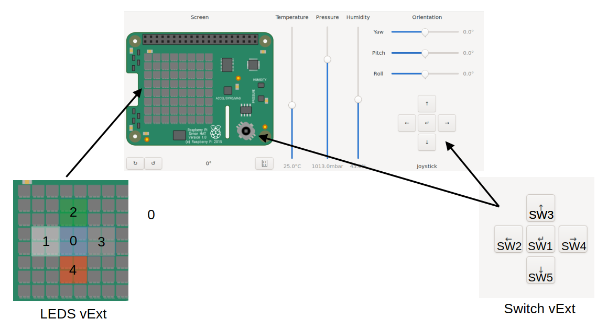

.. _virt32_register_description:

virt extension (vExt) - Register description
============================================

Sense hat emulation layout
==========================

L'extension *vExt* expose 5 LEDs et 5 *switches*, disposés en croix sur la *Sense-HAT* :

Registers
=========

.. note::
   L'adresse de base est ``0x08804000`` (voir ``hw/arm/virt.c``) :

PUSH_BUT_REG
------------

:Address: ``0x12``
:Description: This register contains the values of the push-buttons.
:Reset: Push-button values, bit 15 = '0'
:Type: R

.. list-table::
   :header-rows: 1

   * - 15
     - 14
     - 13
     - 12
     - 11
     - 10
     - 9
     - 8
     - 7
     - 6
     - 5
     - 4
     - 3
     - 2
     - 1
     - 0
   * - TOUCHPAD
     - TP_EN
     -
     -
     -
     -
     -
     -
     - SW8
     - SW7
     - SW6
     - SW5
     - SW4
     - SW3
     - SW2
     - SW1

.. list-table::
   :header-rows: 1
   :widths: 10 15 60 15

   * - Bits
     - Field name
     - Description
     - Type
   * - 7:0
     - SWx
     - Value of the dip switch 
     - R
   * - 13:8
     - unassigned
     - read as '0'
     - R
   * - 14
     - TP_EN
     - touch pad enable, write '1' to this bit before reading the touchpad value
     - RW
   * - 15
     - TOUCHPAD
     - Value of the touch pad
     - R

IRQ_CTRL_REG
------------

:Address: ``0x18``
:Description: This register is used to know the IRQ source and status and to reset to
              '0' the interruption (IRQ) line after an IRQ generation.
:Reset: ``0x0060``
:Type: RW

.. list-table::
   :header-rows: 1

   * - 15
     - 14
     - 13
     - 12
     - 11
     - 10
     - 9
     - 8
     - 7
     - 6
     - 5
     - 4
     - 3
     - 2
     - 1
     - 0
   * -
     -
     -
     -
     -
     -
     -
     -
     - IRQ_ENABLE
     - IRQ_SOURCE
     - IRQ_SOURCE
     - IRQ_STATUS
     - IRQ_BUTTON
     - IRQ_BUTTON
     - IRQ_BUTTON
     - IRQ_CLEAR

.. list-table::
   :header-rows: 1
   :widths: 10 15 60 15

   * - Bits
     - Field name
     - Description
     - Type
   * - 15:8
     -
     - NOT USED, READ AS 0
     - R
   * - 7
     - IRQ_ENABLE
     - Enables the use of IRQ
     - RW
   * - 6:5
     - IRQ_SOURCE
     - when "00": the IRQ source is the standard_interface (pressure on a switch);
       when "01": the IRQ source is the lba_user_interface; when "10": the IRQ source
       is the lbs_user_interface. This field is valid only when IRQ status = '1'.
     - R
   * - 4
     - IRQ_STATUS
     - when '1': an IRQ has been generated; when '0': no event or IRQ has been cleared.
     - R
   * - 3:1
     - IRQ_BUTTON
     - number of the button that has generated the IRQ (0 to 7). This field is valid
       only when IRQ_status = '1' and IRQ_SOURCE = "00".
     - R
   * - 0
     - IRQ_CLEAR
     - write '1' to reset to '0' the interrupt line and to enable a new interrupt
       generation.
     - W

LED_REG
-------

:Address: ``0x3A``
:Description: This register controls the state of the leds.
:Reset: ``0x0000``
:Type: RW

.. list-table::
   :header-rows: 1

   * - 15
     - 14
     - 13
     - 12
     - 11
     - 10
     - 9
     - 8
     - 7
     - 6
     - 5
     - 4
     - 3
     - 2
     - 1
     - 0
   * -
     -
     -
     -
     -
     -
     -
     - LED6_7_EN
     - LED7
     - LED6
     - LED5
     - LED4
     - LED3
     - LED2
     - LED1
     - LED0

.. list-table::
   :header-rows: 1
   :widths: 10 15 60 15

   * - Bits
     - Field name
     - Description
     - Type
   * - 7:0
     - LEDx
     - write '1' to turn the LEDx ON, write '0' to turn it OFF.
     - RW
   * - 8
     - LED6_7_EN
     - write '1' to control the LEDs 6/7 from this register; write '0' to let the
       incremental encoder control these LEDs.
     - RW
   * - 15:9
     - unassigned
     - read as '0'
     - RW
